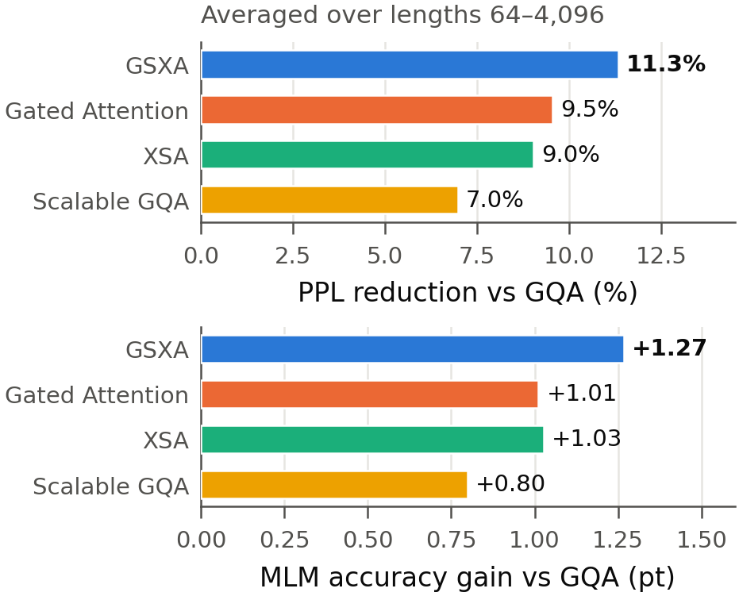
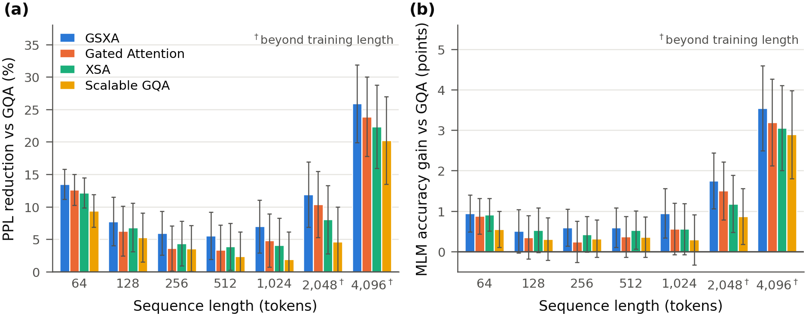

# GSXA: Gated Scalable Exclusive Self Attention

**GSXA** is a drop-in replacement for softmax self-attention that aims at higher
accuracy. It adds three components to scaled dot-product attention:

* a **scalable factor**: a learned, length-dependent query scale;
* an **exclusive projection**: removes, to a learned degree, the part of each head's
  output that points along the token's own value;
* a **per-head gate**.

This repository implements GSXA (PyTorch + 🤗 `transformers`) together with the four
attentions it is compared with, and reports a controlled comparison in a masked-LM
encoder.

<p align="center">
  
</p>

**Figure 1.** Gain over plain GQA, averaged over sequence lengths 64–4,096, for
~100 M-parameter encoders trained identically on 1 B tokens: masked-LM
pseudo-perplexity reduction (top) and MLM-accuracy gain (bottom).

## Method

**Baseline: multi-head attention with GQA.** For an input $X \in \mathbb{R}^{n \times d}$
with $h$ heads of dimension $d_k$, grouped-query attention (Ainslie et al., 2023)
shares the keys and values of the heads within a group, with $\kappa(i)$ the group of
head $i$ (Vaswani et al., 2017):

$$
Q_i = X W_i^Q, \quad K_i = X W_{\kappa(i)}^K, \quad V_i = X W_{\kappa(i)}^V,
$$

$$
\mathrm{head}_i = \mathrm{softmax}\left(\frac{Q_i K_i^\top}{\sqrt{d_k}}\right) V_i,
\qquad
\mathrm{MultiHead}(X) = \mathrm{Concat}(\mathrm{head}_1, \dots, \mathrm{head}_h)\, W^O .
$$

RoPE (Su et al., 2021) is applied to $Q_i$ and $K_i$. GSXA changes this in two places.

**① Scalable factor.** Following Scalable-Softmax (Nakanishi, 2025), the attention
logits are multiplied by a factor that grows with the number of keys $n$:

$$
\mathrm{head}_i = \mathrm{softmax}\left(\lambda_n \frac{Q_i K_i^\top}{\sqrt{d_k}}\right) V_i,
\qquad
\lambda_n = s \log n + \beta + \mathrm{ReLU}(b),
$$

* $s$ and $b$ are learned per layer, and $\beta = 0.1$ is fixed.
* $n$ counts the non-padding tokens.
* SSMax is the case $\lambda_n = s \log n$. The added $\beta + \mathrm{ReLU}(b)$ keeps
  $\lambda_n \ge \beta > 0$ at every length.

**② Exclusive projection and gate.** Let $y_{i,t}$ be the output of head $i$ at
position $t$ (row $t$ of $\mathrm{head}_i$), and $v_{i,t}$ the value of the same token
(row $t$ of $V_i$). A projection $W^G \in \mathbb{R}^{d \times 2h}$ of the
concatenated head outputs gives two gate values per head:

$$
\left[\, g^{(1)}_{t},\ g^{(2)}_{t} \,\right] =
\mathrm{Concat}(y_{1,t}, \dots, y_{h,t})\, W^G, \qquad g^{(1)}_t, g^{(2)}_t \in \mathbb{R}^{h},
$$

$$
z_{i,t} = g^{(1)}_{i,t} \left( y_{i,t} - \tanh\left(g^{(2)}_{i,t}\right)
\frac{y_{i,t}^\top v_{i,t}}{\lVert v_{i,t} \rVert^2}\, v_{i,t} \right),
\qquad
\mathrm{GSXA}(X) = \mathrm{Concat}(Z_1, \dots, Z_h)\, W^O,
$$

where $Z_i$ stacks the $z_{i,t}$ over the positions.

* **What it does.** Split $y_{i,t}$ into a part orthogonal to $v_{i,t}$ ($y^\perp$)
  and a part parallel to it ($y^\parallel$). Then
  $z_{i,t} = g^{(1)}_{i,t}\left(y^{\perp} + \left(1 - \tanh g^{(2)}_{i,t}\right) y^{\parallel}\right)$.
  Each head always passes on what the context adds. It learns how much of the token's
  own value to keep: none (XSA's choice), all ($g^{(2)} = 0$), or more.
* **Cost.** $W^G$ and the two scalars of $\lambda_n$ add 0.22 % parameters at the size
  used below.
* **Code.** `GSXAAttention` in [`src/gsxa/modeling_gsxa.py`](src/gsxa/modeling_gsxa.py).

## Compared methods

All five methods share everything except ① and ②. Select one with
`GSXAConfig(attention_type=...)`.

| Name | `attention_type` | logit scale | head output $z_{i,t}$ |
|:--|:--|:--:|:--|
| **GSXA** | `gsxa` | $\lambda_n$ | $g^{(1)}_{i,t} \left( y_{i,t} - \tanh(g^{(2)}_{i,t}) \frac{y_{i,t}^\top v_{i,t}}{\lVert v_{i,t} \rVert^2} v_{i,t} \right)$ |
| Gated Attention | `gated` | $\lambda_n$ | $g^{(1)}_{i,t}\, y_{i,t}$ |
| XSA | `xsa` | $\lambda_n$ | $y_{i,t} - \frac{y_{i,t}^\top v_{i,t}}{\lVert v_{i,t} \rVert^2} v_{i,t}$ |
| Scalable GQA | `scalable_gqa` | $\lambda_n$ | $y_{i,t}$ |
| GQA | `gqa` | $1$ | $y_{i,t}$ |

* **GQA**: grouped-query attention with RoPE (Ainslie et al., 2023; Su et al., 2021).
* **Scalable GQA**: GQA with the scalable factor ①.
* **XSA**: Exclusive Self Attention (Zhai, 2026), $z_i = y_i - \frac{y_i^\top v_i}{\lVert v_i \rVert^2} v_i$,
  applied per head.
* **Gated Attention**: GSXA's gate alone, $g^{(1)}$ computed from the head outputs.
  It differs from the gate of Qiu et al. (2025), $Y' = Y \odot \sigma(X W_\theta)$,
  which is a sigmoid of the layer input.

## Results

**Setup.** All five models are 12-layer encoders: width 768, 12 query / 4 KV heads,
RoPE θ = 100,000, a ReLU² MLP of 2,304, 100.7–100.9 M parameters. Each was trained
once, on 1 B tokens of English web and code at sequence length 1,024. The recipe and
data order are identical: masked LM with 30 % masking, batch 512, AdamW at learning
rate 6 × 10⁻⁴ with cosine decay, seed 1234. Evaluation uses held-out text: for each
length, 20 measurements of 65,536 tokens with 15 % masking, reported as mean ± 95 % CI.
The metrics are pseudo-perplexity (PPPL, Salazar et al., 2020) and MLM accuracy. Raw
scores are in [`results/attention_ablation/`](results/attention_ablation).

**Table 1.** Masked-LM quality by sequence length († = beyond the training length;
bold = best in the column).

*Pseudo-perplexity ↓*

| Model | 64 | 128 | 256 | 512 | 1,024 | 2,048† | 4,096† |
|:--|--:|--:|--:|--:|--:|--:|--:|
| GSXA | **18.53 ± 0.35** | **13.51 ± 0.39** | **11.25 ± 0.29** | **10.18 ± 0.28** | **9.67 ± 0.30** | **9.82 ± 0.40** | **10.69 ± 0.49** |
| Gated Attention | 18.72 ± 0.36 | 13.72 ± 0.39 | 11.52 ± 0.30 | 10.42 ± 0.30 | 9.89 ± 0.30 | 9.99 ± 0.39 | 10.98 ± 0.49 |
| XSA | 18.82 ± 0.33 | 13.64 ± 0.38 | 11.43 ± 0.29 | 10.36 ± 0.27 | 9.97 ± 0.31 | 10.25 ± 0.42 | 11.20 ± 0.54 |
| Scalable GQA | 19.41 ± 0.40 | 13.86 ± 0.38 | 11.53 ± 0.31 | 10.52 ± 0.28 | 10.20 ± 0.31 | 10.64 ± 0.42 | 11.50 ± 0.60 |
| GQA | 21.42 ± 0.41 | 14.64 ± 0.42 | 11.95 ± 0.30 | 10.78 ± 0.29 | 10.39 ± 0.32 | 11.15 ± 0.45 | 14.42 ± 0.97 |

*MLM accuracy (%) ↑*

| Model | 64 | 128 | 256 | 512 | 1,024 | 2,048† | 4,096† |
|:--|--:|--:|--:|--:|--:|--:|--:|
| GSXA | **47.87 ± 0.34** | 52.20 ± 0.39 | **55.04 ± 0.33** | **56.45 ± 0.36** | **57.37 ± 0.43** | **57.33 ± 0.49** | **56.23 ± 0.66** |
| Gated Attention | 47.80 ± 0.32 | 52.05 ± 0.39 | 54.69 ± 0.39 | 56.22 ± 0.39 | 56.98 ± 0.47 | 57.08 ± 0.52 | 55.88 ± 0.69 |
| XSA | 47.84 ± 0.27 | **52.22 ± 0.41** | 54.88 ± 0.30 | 56.38 ± 0.34 | 56.98 ± 0.46 | 56.76 ± 0.51 | 55.74 ± 0.67 |
| Scalable GQA | 47.48 ± 0.33 | 52.01 ± 0.38 | 54.77 ± 0.33 | 56.21 ± 0.38 | 56.72 ± 0.44 | 56.45 ± 0.49 | 55.58 ± 0.72 |
| GQA | 46.93 ± 0.30 | 51.70 ± 0.37 | 54.45 ± 0.32 | 55.85 ± 0.32 | 56.43 ± 0.43 | 55.58 ± 0.49 | 52.69 ± 0.81 |

<p align="center">
  
</p>

**Figure 2.** Gain over GQA at each length. The whiskers are 95 % CIs that treat the
two models as independent; they are conservative, since all models share the
evaluation windows and masks.

* GSXA has the lowest pseudo-perplexity at every length and the highest MLM accuracy
  at all but one (128).
* Against GQA it reduces pseudo-perplexity by 7.0 % at the training length. The
  intervals do not overlap there. Beyond the training length the reduction is
  11.9 % at 2,048 and 25.9 % at 4,096.
* Against the other Scalable-GQA variants its margin at any single length is within
  the intervals. What sets it apart is that it leads consistently across all lengths.
  The comparison rests on one training run per model.

## Speed

Encoder forward pass with `torch.compile`, 32 × 1,024 tokens, bf16, one RTX 5080.
The models are timed in 10 interleaved rounds, each the median of 50 forwards. The
table gives the mean ± 95 % CI over the rounds. The change vs GQA is paired within
each round.

| | GSXA | Gated Attention | XSA | Scalable GQA | GQA |
|:--|--:|--:|--:|--:|--:|
| latency (ms) | 82.14 ± 0.09 | 81.14 ± 0.08 | 81.70 ± 0.08 | 80.29 ± 0.08 | 80.22 ± 0.07 |
| vs GQA | +2.39 ± 0.11 % | +1.14 ± 0.11 % | +1.84 ± 0.11 % | +0.08 ± 0.11 % | — |

To reproduce: `python benchmarks/benchmark_inference.py`, then
`python benchmarks/make_tables.py <result json>`.

## Usage

```bash
pip install -e .            # torch >= 2.4, transformers >= 5.0
```

```python
import torch
from gsxa import GSXAConfig, GSXAForMaskedLM

model = GSXAForMaskedLM(GSXAConfig(attention_type="gsxa"))      # 12 x 768, untrained
model = GSXAForMaskedLM.from_pretrained("path/to/checkpoint", dtype=torch.bfloat16)
```

* `GSXAModel`, `GSXAForMaskedLM` and `GSXAForSequenceClassification` are standard
  `transformers` models. A saved checkpoint also loads without this package, through
  `AutoModel*.from_pretrained(path, trust_remote_code=True)`.
* The tokenizer is ModernBERT's: `answerdotai/ModernBERT-base`.
* [`scripts/convert_nexterabert_v2.py`](scripts/convert_nexterabert_v2.py) converts
  the ablation checkpoints, which were trained with a separate pipeline (NexteraBERTv2).
  The conversion is exact.
* [`examples/quickstart.py`](examples/quickstart.py) shows fill-mask, embeddings and
  classification.
* `python -m pytest -q tests` runs the CPU tests.
* `python results/make_figures.py --tables` redraws the figures and tables.

## References

* S. Zhai. *Exclusive Self Attention.* arXiv:2603.09078, 2026.
* Z. Qiu et al. *Gated Attention for Large Language Models: Non-linearity, Sparsity,
  and Attention-Sink-Free.* arXiv:2505.06708, 2025.
* K. M. Nakanishi. *Scalable-Softmax Is Superior for Attention.* arXiv:2501.19399, 2025.
* A. Vaswani et al. *Attention Is All You Need.* NeurIPS 2017.
* J. Ainslie et al. *GQA: Training Generalized Multi-Query Transformer Models from
  Multi-Head Checkpoints.* arXiv:2305.13245, 2023.
* J. Su et al. *RoFormer: Enhanced Transformer with Rotary Position Embedding.*
  arXiv:2104.09864, 2021.
* J. Salazar et al. *Masked Language Model Scoring.* ACL 2020.

## Citation

```bibtex
@misc{gsxa,
  title        = {{GSXA}: Gated Scalable Exclusive Self Attention},
  author       = {Rikka Botan},
  year         = {2026},
  howpublished = {\url{https://github.com/Rikka-Botan/GSXA}}
}
```

## License

MIT — see [LICENSE](LICENSE).
