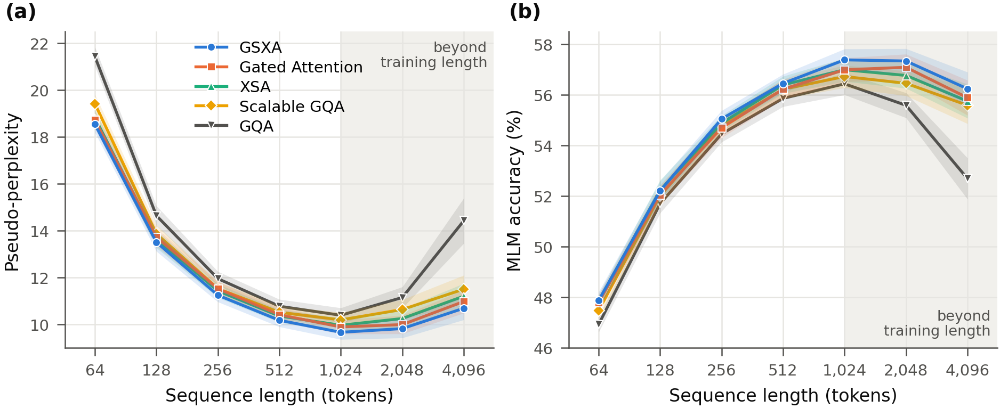
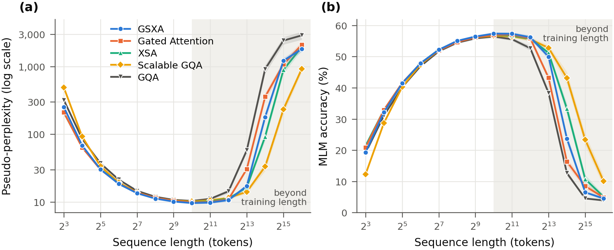

# GSXA: Gated Scalable Exclusive Self Attention

**GSXA** is an attention layer for bidirectional encoders. It combines three
changes to standard scaled dot-product attention:

* a **scalable factor**, a learned, length-dependent query scale;
* an **exclusive projection**, which removes, to a learned degree, the part of each
  head's output that points along the token's *own* value vector;
* a **per-head gate** on the result.

This repository contains **inference code** (PyTorch + 🤗 `transformers`):

* a BERT-style masked-language-model encoder (grouped-query attention + RoPE +
  squared-ReLU MLP) with GSXA attention, plus masked-LM and sequence-classification
  heads and `save_pretrained` / `from_pretrained` support;
* the four attention variants GSXA is compared with, selectable by one config field;
* a controlled ablation of the five at ~100 M parameters, and speed measurements;
* a converter for the checkpoints of that ablation.

**Summary of the results** (5 models × 100.7–100.9 M parameters, 1 B tokens at
1,024 tokens, identical recipe and seed; one training run each):

* From 64 to 4,096 tokens, GSXA has the **lowest masked-LM pseudo-perplexity of the
  five at every length**. Averaged over that range, it reduces pseudo-perplexity by
  **11.3 %** relative to plain GQA. The next best models reach 9.5 % (Gated
  Attention), 9.0 % (XSA) and 7.0 % (Scalable GQA) (Figure 1, Figure 2).
* MLM accuracy agrees. GSXA gains **+1.27 points** over GQA on that range, against
  +1.01 (Gated Attention), +1.03 (XSA) and +0.80 (Scalable GQA).
* At the training length (1,024), GSXA's pseudo-perplexity is 9.67 ± 0.30, against
  10.39 ± 0.32 for GQA (−7.0 %). At 4,096 tokens (4× the training length) it is
  10.69 against 14.42 (−25.9 %).
* The results are reported for 64–4,096 tokens: from 64 tokens up to 4× the training
  length. The full sweep that was measured, 8–65,536 tokens, is in the
  [Appendix](#appendix-the-full-sweep-8--65536-tokens). At its two ends other variants
  lead: Gated Attention and XSA below 64 tokens, Scalable GQA from 8,192.
* GSXA adds 0.22 % parameters (a 768 × 24 matrix and two scalars per layer).
  Compiled with `torch.compile`, it adds 0.8–3.3 % to the encoder's forward latency
  over GQA, from 64 × 128 to 2 × 8192 tokens per batch ([Speed](#speed)).

---

## Contents

1. [Method](#method)
2. [Compared methods](#compared-methods)
3. [Results](#results)
4. [Usage](#usage)
5. [Architecture](#architecture)
6. [Speed](#speed)
7. [Install, tests, layout](#install)
8. [References](#references) · [Citation](#citation) · [License](#license)

## Method

### Notation

One attention layer reads $X \in \mathbb{R}^{T \times d}$ (the pre-normed residual
stream; $T$ tokens, model width $d$). Its $H$ query heads of width $D = d / H$ share
$H_{kv}$ key/value heads (grouped-query attention, $G = H / H_{kv}$ query heads per
group), and query head $h$ reads KV head

$$\kappa(h) = \lfloor h / G \rfloor .$$

For token $t$:

$$
q_t^h = W_Q^h x_t, \qquad k_t^{j} = W_K^{j} x_t, \qquad v_t^{j} = W_V^{j} x_t
\qquad (h = 1..H,\ j = 1..H_{kv}),
$$

with no biases. $m_j \in \{0, 1\}$ marks the non-padding tokens. Every model below
uses these projections and differs only in the two places marked ① and ②.

### Rotary positions

Queries and keys are rotated pairwise. Channel $i$ is paired with channel
$i + D/2$, and the pair is rotated by the angle $-t\,\omega_i$, where
$\omega_i = \theta^{-2i/D}$ and $\theta = 100{,}000$:

$$
\mathrm{R}_t \begin{pmatrix} a_i \\ a_{i+D/2} \end{pmatrix} =
\begin{pmatrix} \cos t\omega_i & \sin t\omega_i \\ -\sin t\omega_i & \cos t\omega_i \end{pmatrix}
\begin{pmatrix} a_i \\ a_{i+D/2} \end{pmatrix},
\qquad \tilde q_t^h = \mathrm{R}_t q_t^h,\quad \tilde k_t^{j} = \mathrm{R}_t k_t^{j}.
$$

The score $\langle \tilde q_t, \tilde k_s \rangle$ depends on the offset $s - t$ only.
This is the usual rotate-half RoPE with the angle negated. The two signs are
equivalent for training from scratch, but not for the trained weights, so the code
keeps the sign the checkpoints were trained with.

### ① Scalable factor

Each layer $\ell$ has two learned scalars, $s_\ell$ and $b_\ell$, and a fixed floor
$\beta = 0.1$. The queries of a sequence with $n = \sum_j m_j$ non-padding tokens
are scaled by

$$
\lambda_\ell(n) = s_\ell \log n + \beta + \operatorname{ReLU}(b_\ell),
\qquad s_\ell^{(0)} = 0.43,\quad b_\ell^{(0)} = 0.1 .
$$

The attention weights and the per-head output are then

$$
a_{ts}^h = \operatorname*{softmax}_{s:\,m_s = 1}
\left( \frac{\lambda_\ell(n)\, \langle \tilde q_t^h, \tilde k_s^{\kappa(h)} \rangle}{\sqrt{D}} \right),
\qquad
o_t^h = \sum_s a_{ts}^h\, v_s^{\kappa(h)} \in \mathbb{R}^D .
$$

* **Why it helps.** As $n$ grows, softmax attention over $n$ keys flattens:
  Nakanishi (2025) calls this *attention fading*. Scaling the logits by
  $s \log n$ keeps the distribution about as peaked at any length.
* **Why the floor.** Plain $s \log n$ is $0$ at $n = 1$. With the floor $\beta$ and
  the non-negative $\operatorname{ReLU}(b)$, $\lambda \ge \beta > 0$ at every length
  and for any learned $b$: the scale cannot vanish or change sign.
* **What $n$ counts.** $n$ is the number of real keys, so a padded sequence is
  treated exactly as the same sequence alone.

### ② Output transform: exclusive projection and gate

Let $\hat v_t^h = v_t^{\kappa(h)} / \lVert v_t^{\kappa(h)} \rVert_2$ be the
direction of token $t$'s own value in head $h$'s group. Let
$o_t = [o_t^1; \dots; o_t^H] \in \mathbb{R}^d$ be the concatenated attention output.
A bias-free linear map $W_G \in \mathbb{R}^{2H \times d}$ gives two scalars per head:

$$
\big[\, g_{1,t}^1, \dots, g_{1,t}^H,\ g_{2,t}^1, \dots, g_{2,t}^H \,\big] = W_G\, o_t .
$$

GSXA replaces each head's output by

$$
\boxed{\;
z_t^h = g_{1,t}^h \Big( o_t^h - \tanh\!\big(g_{2,t}^h\big)\,
\big\langle o_t^h, \hat v_t^h \big\rangle\, \hat v_t^h \Big)
\;}
\qquad\text{and}\qquad
y_t = W_O\, [z_t^1; \dots; z_t^H].
$$

To see what this does, split the head output into its component along its own value
direction and the orthogonal rest,
$o = o_{\parallel} + o_{\perp}$ with $o_{\parallel} = \langle o, \hat v \rangle \hat v$:

$$
z = g_1 \big( o_{\perp} + (1 - \tanh g_2)\, o_{\parallel} \big),
\qquad 1 - \tanh g_2 \in (0, 2).
$$

* **The exclusive term.** Attention outputs tend to be highly similar to the token's
  own value (Zhai, 2026). That self-information already reaches the next layer
  through the residual path, so carrying it again in $o$ spends attention capacity
  on it.
  * XSA removes $o_{\parallel}$ entirely.
  * GSXA instead learns, per token and per head, how much of it to keep: removed
    ($\tanh g_2 \to 1$, as XSA), kept ($g_2 = 0$, plain attention) or amplified
    ($\tanh g_2 < 0$). The context-only part $o_{\perp}$ is always passed on.
* **The gate.** $g_1$ rescales each head as a whole and can switch it off. It is
  linear (no sigmoid), so its sign is learned too. Both gates are computed from
  the attention output itself: the gate sees what the head retrieved.
* **Cost.** $W_G$ adds $2Hd$ parameters per layer. Here that is 18,432, or 0.22 % of
  the model. The transform adds two $D$-dimensional dot products per head and token
  and one $d \times 2H$ matrix product per token.
* **Initialisation.** $W_G$ starts small, so at the start $g_2 \approx 0$ and
  $\tanh g_2 \approx 0$: GSXA begins as gated attention and learns the exclusive
  term. This package draws $W_G \sim \mathcal{N}(0, 0.02^2)$. The ablation models
  were initialised by their training pipeline, with a fan-in-scaled
  $\sigma \approx 0.0064$ for $W_G$.

### Pseudocode

```python
# x: (B, T, d) pre-normed input;  n: (B,) number of non-padding tokens
q, k, v = split(x @ W_qkv)                                  # (B,T,H,D), (B,T,Hkv,D) x 2
q, k = rope(q), rope(k)
q = q * (s * log(n) + beta + relu(b))                       # (1) scalable factor
o = sdpa(q, repeat_kv(k), repeat_kv(v), key_padding_mask)   # (B,T,H,D), scale 1/sqrt(D)
g1, g2 = split(o.flatten(-2) @ W_G, 2)                      # (B,T,H) each
vhat = normalize(v, dim=-1)[:, :, kappa]                    # own value, per query head
z = g1[..., None] * (o - tanh(g2)[..., None] * (o * vhat).sum(-1, keepdim=True) * vhat)  # (2)
y = z.flatten(-2) @ W_O
```

The implementation is `GSXAAttention` in
[`src/gsxa/modeling_gsxa.py`](src/gsxa/modeling_gsxa.py).
`tests/test_modeling.py` checks it head by head against the equations above.

## Compared methods

The ablation trains five models that are identical except for ① and ②. The names
below are the ones used throughout the results. Each is selected by
`GSXAConfig(attention_type=...)`.

| Name | `attention_type` | ① query scale $\lambda$ | ② head output $z^h$ | Parameters added per layer |
|:--|:--|:--|:--|--:|
| **GSXA** (proposed) | `gsxa` | $s\log n + \beta + \operatorname{ReLU}(b)$ | $g_1^h\,(o^h - \tanh(g_2^h) \langle o^h, \hat v^h \rangle \hat v^h)$ | $2Hd + 2$ = 18,434 |
| Gated Attention | `gated` | $s\log n + \beta + \operatorname{ReLU}(b)$ | $g_1^h\, o^h$, with $[g_1^1..g_1^H] = W_G o$ | $Hd + 2$ = 9,218 |
| XSA | `xsa` | $s\log n + \beta + \operatorname{ReLU}(b)$ | $o^h - \langle o^h, \hat v^h \rangle \hat v^h$ | 2 |
| Scalable GQA | `scalable_gqa` | $s\log n + \beta + \operatorname{ReLU}(b)$ | $o^h$ | 2 |
| GQA | `gqa` | $1$ | $o^h$ | — |

**GQA**: grouped-query attention (Ainslie et al., 2023) with rotary positions
(Su et al., 2021), the standard attention of current encoders. It is the reference
every other model is measured against.

**Scalable GQA**: GQA with the scalable factor ①. The factor is Scalable-Softmax
(SSMax, Nakanishi, 2025), which multiplies the attention logits by $s \log n$, plus
the floor $\beta + \operatorname{ReLU}(b)$ described above. It isolates what the
length scaling alone contributes.

**XSA**: Exclusive Self Attention (Zhai, 2026), here on top of Scalable GQA. It
subtracts each output's projection onto the token's own value,
$z = o - \frac{\langle o, v \rangle}{\lVert v \rVert^2} v$, so attention carries only
what is orthogonal to the token itself. This is the paper's parameter-free form. With
GQA, a query head uses the value of its own KV group.

**Gated Attention**: a per-head output gate, here on top of Scalable GQA. It is
GSXA without the exclusive term: $z^h = g_1^h o^h$, with $g_1 = W_G o$ linear and
computed from the attention output. It is related to, but **not** the same as, the
gated attention of Qiu et al. (2025), which multiplies the attention output by
$\sigma(X W_\theta)$:

* their gate is a sigmoid, ours is linear;
* their gate is computed from the layer's input hidden states, ours from the
  attention output;
* their best variant is elementwise, ours is per head.

The name refers to the ablation of GSXA's gate, not to a reproduction of that paper.

**GSXA**: Scalable GQA with both terms. Its exclusive projection is the learned
$\tanh(g_2)$ version, not XSA's fixed full projection. The four Scalable-GQA models
therefore do not form a strict 2 × 2 factorial.

## Results

### Setup

**Table 1.** The five models. Everything except the attention's ① and ② is shared.

| | GSXA | Gated Attention | XSA | Scalable GQA | GQA |
|:--|:--:|:--:|:--:|:--:|:--:|
| layers × hidden, MLP | 12 × 768, ReLU² 2,304 | same | same | same | same |
| attention | 12 query / 4 KV heads, head dim 64, RoPE θ = 100,000, full bidirectional | same | same | same | same |
| norm | RMSNorm pre-norm, final LayerNorm | same | same | same | same |
| parameters (MLM / encoder) | 100,906,456 / 100,265,496 | 100,795,864 / 100,154,904 | 100,685,272 / 100,044,312 | 100,685,272 / 100,044,312 | 100,685,248 / 100,044,288 |

The models were trained with a separate pipeline (NexteraBERTv2), not part of this
repository. Its models carry 592,128 parameters this package does not have: a
pooler and segment embeddings. MLM pretraining never trains these, so they are
dropped on conversion, and the score JSONs record the larger counts.

**Table 2.** Training recipe, shared by all five models.

| | |
|:--|:--|
| data | English web + code: [Ultra-FineWeb-L1](https://huggingface.co/datasets/openbmb/Ultra-FineWeb-L1) (six CC-MAIN-2025 snapshots) 55 %, [DCLM-Edu](https://huggingface.co/datasets/HuggingFaceTB/dclm-edu) 35 %, [UltraData-Code](https://huggingface.co/datasets/openbmb/UltraData-Code) (L3, 11 languages) 10 %, shares exact in tokens; ModernBERT tokenizer |
| examples | one document per example, ≤ 1,024 tokens, batches padded dynamically |
| tokens | 1 B content tokens; no long-context extension |
| objective | masked LM, constant 30 % masking (80 / 10 / 10) |
| batch | 512 sequences (global) |
| optimizer | AdamW, β = (0.9, 0.95), ε = 10⁻⁸, weight decay 0.1 on matrices (not on norms, biases or the scalable-factor scalars), gradient clip 1.0 |
| learning rate | peak 6 × 10⁻⁴; linear warmup over 6 % of the steps; cosine decay to 10 % |
| precision | bf16 autocast, `torch.compile` |
| seed | 1234 for every model: identical data order and masking. Initial weights are drawn from the same seed, but the models create different parameters, so they are not identical. |

**Evaluation protocol.**

* **Data.** Held-out text that no model saw: a disjoint 0.1 % slice of the same
  55 / 35 / 10 mix, with documents packed back to back.
* **Windows.** For each length L ∈ {2³, …, 2¹⁶} there are 20 measurements of 65,536
  tokens each, so every measurement uses 65,536 / L full windows and no padding.
  Windows are spread evenly over the shard. The results below cover
  L = 64 … 4,096; every length is in the
  [Appendix](#appendix-the-full-sweep-8--65536-tokens).
* **Masking.** 15 % of the non-special tokens are replaced by `[MASK]`, from a fixed
  seed. All models are scored on the same windows with the same positions masked.
* **Metrics.**
  * Pseudo-perplexity (PPPL): exp of the mean cross-entropy over the masked positions
    (the one-pass estimator of Salazar et al., 2020).
  * MLM accuracy: top-1 accuracy at the masked positions.
  * Each value is the mean ± 95 % Student-t confidence interval over the 20
    measurements. Inference runs in bf16 autocast.

### Gains over GQA, 64–4,096 tokens

<p align="center">
  
</p>

**Figure 1.** Gains over GQA averaged over the sequence lengths 64, 128, 256, 512,
1,024, 2,048 and 4,096. That is the range in which GSXA has the lowest
pseudo-perplexity at every single length. Top: geometric-mean reduction of the
pseudo-perplexity. Bottom: mean gain in MLM accuracy (points).
[PDF](docs/figures/fig1_bars_summary.pdf)

<p align="center">
  
</p>

**Figure 2.** The same gains at each length. (a) Pseudo-perplexity reduction (%).
(b) MLM-accuracy gain (points). † marks lengths beyond the training length.
Whiskers are 95 % CIs of the difference. They treat the two models' intervals as
independent, which overstates them, because the windows and masks are shared.
[PDF](docs/figures/fig2_bars_by_length.pdf)

| Model | PPPL reduction vs GQA, 64–4,096 (geo. mean) | MLM accuracy gain vs GQA, 64–4,096 (mean) |
|:--|--:|--:|
| **GSXA** | **11.34 %** | **+1.27** |
| Gated Attention | 9.55 % | +1.01 |
| XSA | 9.03 % | +1.03 |
| Scalable GQA | 6.97 % | +0.80 |

### Pseudo-perplexity and MLM accuracy, 64–4,096 tokens

**Table 3.** Masked-LM quality versus sequence length (mean ± 95 % CI over 20
measurements). All models were trained at 1,024 tokens; † marks extrapolation. Bold
marks the best model in each column. The intervals of the top models overlap
([Findings](#findings)).

*(a) Pseudo-perplexity ↓*

| Model | 64 | 128 | 256 | 512 | 1,024 | 2,048† | 4,096† |
|:--|--:|--:|--:|--:|--:|--:|--:|
| GSXA | **18.53 ± 0.35** | **13.51 ± 0.39** | **11.25 ± 0.29** | **10.18 ± 0.28** | **9.67 ± 0.30** | **9.82 ± 0.40** | **10.69 ± 0.49** |
| Gated Attention | 18.72 ± 0.36 | 13.72 ± 0.39 | 11.52 ± 0.30 | 10.42 ± 0.30 | 9.89 ± 0.30 | 9.99 ± 0.39 | 10.98 ± 0.49 |
| XSA | 18.82 ± 0.33 | 13.64 ± 0.38 | 11.43 ± 0.29 | 10.36 ± 0.27 | 9.97 ± 0.31 | 10.25 ± 0.42 | 11.20 ± 0.54 |
| Scalable GQA | 19.41 ± 0.40 | 13.86 ± 0.38 | 11.53 ± 0.31 | 10.52 ± 0.28 | 10.20 ± 0.31 | 10.64 ± 0.42 | 11.50 ± 0.60 |
| GQA | 21.42 ± 0.41 | 14.64 ± 0.42 | 11.95 ± 0.30 | 10.78 ± 0.29 | 10.39 ± 0.32 | 11.15 ± 0.45 | 14.42 ± 0.97 |

*(b) MLM accuracy (%) ↑*

| Model | 64 | 128 | 256 | 512 | 1,024 | 2,048† | 4,096† |
|:--|--:|--:|--:|--:|--:|--:|--:|
| GSXA | **47.87 ± 0.34** | 52.20 ± 0.39 | **55.04 ± 0.33** | **56.45 ± 0.36** | **57.37 ± 0.43** | **57.33 ± 0.49** | **56.23 ± 0.66** |
| Gated Attention | 47.80 ± 0.32 | 52.05 ± 0.39 | 54.69 ± 0.39 | 56.22 ± 0.39 | 56.98 ± 0.47 | 57.08 ± 0.52 | 55.88 ± 0.69 |
| XSA | 47.84 ± 0.27 | **52.22 ± 0.41** | 54.88 ± 0.30 | 56.38 ± 0.34 | 56.98 ± 0.46 | 56.76 ± 0.51 | 55.74 ± 0.67 |
| Scalable GQA | 47.48 ± 0.33 | 52.01 ± 0.38 | 54.77 ± 0.33 | 56.21 ± 0.38 | 56.72 ± 0.44 | 56.45 ± 0.49 | 55.58 ± 0.72 |
| GQA | 46.93 ± 0.30 | 51.70 ± 0.37 | 54.45 ± 0.32 | 55.85 ± 0.32 | 56.43 ± 0.43 | 55.58 ± 0.49 | 52.69 ± 0.81 |

<p align="center">
  
</p>

**Figure 3.** Masked-LM quality from 64 to 4,096 tokens. (a) Pseudo-perplexity
(lower is better). (b) MLM accuracy (higher is better). Shaded bands are 95 % CIs
over 20 measurements. The grey region is beyond the training length (1,024).
[PDF](docs/figures/fig3_quality_vs_length.pdf)

### Findings

1. **GSXA is the best of the five at every length from 64 to 4,096.**
   * Its pseudo-perplexity is the lowest at all seven lengths.
   * Its MLM accuracy is the highest at six of them. At 128 it trails XSA by 0.02
     points.
2. **Its lead over GQA holds at every length, and is largest at the two ends of the
   range** (−5.6 % at 512, the smallest; −13.5 % at 64; −25.9 % at 4,096).
   * At 64 tokens GSXA's pseudo-perplexity is −13.5 % and its accuracy +0.94 points.
   * At 1,024, the training length, it is −7.0 % (9.67 ± 0.30 vs 10.39 ± 0.32; the
     intervals do not overlap) and +0.95 points.
   * At 2,048 and 4,096, beyond the training length, it is −11.9 % and −25.9 %, with
     +1.75 and +3.54 points of accuracy.
3. **Each component helps, and GSXA's combination helps most.**
   * Averaged over 64–4,096, the scalable factor alone (Scalable GQA) reduces
     pseudo-perplexity by 7.0 %.
   * Adding the gate brings that to 9.5 % (Gated Attention), and adding the exclusive
     projection brings it to 9.0 % (XSA).
   * Both together, with the exclusive term's strength learned (GSXA), give 11.3 %:
     more than either.
   * At a single length, GSXA's margin over Gated Attention and XSA is within the
     intervals: for example 9.67 against 9.89 and 9.97 at 1,024. The evidence for
     its lead is its consistency: first at every length in the range, on both
     metrics but one cell.
4. **The cost is small.** GSXA adds 221,208 parameters to GQA: $W_G$ and two
   scalars per layer, 0.22 %. Compiled, it adds 0.8–3.3 % to the forward latency
   ([Speed](#speed)).

### Limitations

* **The reported range.** The main results cover 64–4,096 tokens. Outside it GSXA
  is not the best model: Gated Attention and XSA lead on 8–32 tokens, and Scalable
  GQA alone extrapolates best from 8,192 tokens. Both are documented in the
  [Appendix](#appendix-the-full-sweep-8--65536-tokens).
* **One training run per model.** The CIs cover evaluation sampling (which text is
  scored), not run-to-run training variance. The gaps between GSXA and the other
  Scalable-GQA models at a single length are a few tenths of a point. They need more
  seeds before they can be relied on one by one.
* **One scale and one training phase.** The study covers ~100 M parameters, 1 B
  tokens and 1,024 tokens of context, with no long-context training. Nothing here
  measures downstream (GLUE, retrieval) quality.
* **"Gated Attention" is GSXA's gate, not Qiu et al.'s.** The comparison isolates the
  terms of GSXA. It does not compare against that paper's sigmoid gate computed from
  the input.
* **The long end measures concatenated documents.** The evaluation shard packs
  documents back to back, so windows longer than a document span several documents.
  All models see identical windows, so the comparison is fair, but the absolute
  long-length numbers are not those of single long documents.
* **The CIs of differences are approximate.** Per-measurement values were not
  stored, so the paired test the shared windows would allow could not be run. The
  independent-sample intervals in Figure 2 are conservative.

### Appendix: the full sweep (8 – 65,536 tokens)

Every length that was measured, for completeness. These are the same models and the
same protocol as above.

* **Below 64 tokens, Gated Attention and XSA lead.**
  * At 8 and 16 tokens they are the best models, and GSXA is behind them, though
    still ahead of GQA. At 8 tokens the pseudo-perplexities are: XSA 209.5, Gated
    Attention 211.7, GSXA 252.8, GQA 319.8.
  * At 32 tokens Gated Attention, GSXA and XSA are within each other's intervals.
  * Scalable GQA alone is worse than GQA there: +53.6 % pseudo-perplexity at 8
    tokens and +8.0 % at 16.
* **From 8,192 tokens (8× the training length), Scalable GQA extrapolates best.**
  * Every model trained at 1,024 degrades past 4,096, but the ones with the scalable
    factor degrade far more slowly than GQA.
  * At 8,192 tokens the pseudo-perplexities are: Scalable GQA 14.2, XSA 16.6,
    GSXA 17.3, Gated Attention 30.8, GQA 58.2.
  * At 16,384 they are 33.4, 92.4, 179.8, 358.0 and 918.7 in the same order. The
    gate costs the most out there.

*Pseudo-perplexity ↓*

| Length | GSXA | Gated Attention | XSA | Scalable GQA | GQA |
|--:|--:|--:|--:|--:|--:|
| 8 | 252.837 ± 4.165 | 211.717 ± 3.260 | 209.457 ± 3.580 | 491.125 ± 8.057 | 319.815 ± 5.438 |
| 16 | 68.567 ± 1.425 | 63.983 ± 1.345 | 64.996 ± 1.331 | 92.877 ± 2.027 | 85.997 ± 1.734 |
| 32 | 30.483 ± 0.653 | 30.229 ± 0.613 | 30.626 ± 0.684 | 33.886 ± 0.727 | 37.398 ± 0.899 |
| 64 | 18.534 ± 0.349 | 18.716 ± 0.361 | 18.819 ± 0.334 | 19.411 ± 0.396 | 21.423 ± 0.409 |
| 128 | 13.505 ± 0.388 | 13.722 ± 0.394 | 13.642 ± 0.378 | 13.863 ± 0.380 | 14.640 ± 0.422 |
| 256 | 11.247 ± 0.285 | 11.524 ± 0.297 | 11.432 ± 0.289 | 11.527 ± 0.306 | 11.954 ± 0.304 |
| 512 | 10.178 ± 0.278 | 10.415 ± 0.296 | 10.362 ± 0.272 | 10.520 ± 0.283 | 10.778 ± 0.293 |
| 1,024 | 9.665 ± 0.303 | 9.892 ± 0.300 | 9.966 ± 0.310 | 10.195 ± 0.312 | 10.391 ± 0.316 |
| 2,048 | 9.823 ± 0.396 | 9.994 ± 0.395 | 10.253 ± 0.416 | 10.638 ± 0.420 | 11.149 ± 0.453 |
| 4,096 | 10.691 ± 0.491 | 10.978 ± 0.491 | 11.205 ± 0.544 | 11.504 ± 0.596 | 14.424 ± 0.965 |
| 8,192 | 17.322 ± 1.219 | 30.788 ± 2.102 | 16.596 ± 1.034 | 14.190 ± 0.844 | 58.241 ± 4.901 |
| 16,384 | 179.830 ± 25.201 | 358.042 ± 45.750 | 92.399 ± 12.958 | 33.373 ± 4.808 | 918.707 ± 131.961 |
| 32,768 | 1222.177 ± 126.971 | 1080.214 ± 143.615 | 893.498 ± 117.902 | 232.660 ± 35.202 | 2416.658 ± 303.645 |
| 65,536 | 1810.999 ± 172.621 | 2093.980 ± 235.519 | 1947.250 ± 198.891 | 921.180 ± 101.680 | 2882.957 ± 394.889 |

*MLM accuracy (%) ↑*

| Length | GSXA | Gated Attention | XSA | Scalable GQA | GQA |
|--:|--:|--:|--:|--:|--:|
| 8 | 19.28 ± 0.19 | 20.86 ± 0.21 | 21.40 ± 0.20 | 12.27 ± 0.17 | 19.09 ± 0.20 |
| 16 | 32.14 ± 0.28 | 32.89 ± 0.22 | 32.86 ± 0.26 | 28.70 ± 0.24 | 31.07 ± 0.28 |
| 32 | 41.44 ± 0.28 | 41.57 ± 0.30 | 41.47 ± 0.28 | 40.26 ± 0.30 | 40.19 ± 0.31 |
| 64 | 47.87 ± 0.34 | 47.80 ± 0.32 | 47.84 ± 0.27 | 47.48 ± 0.33 | 46.93 ± 0.30 |
| 128 | 52.20 ± 0.39 | 52.05 ± 0.39 | 52.22 ± 0.41 | 52.01 ± 0.38 | 51.70 ± 0.37 |
| 256 | 55.04 ± 0.33 | 54.69 ± 0.39 | 54.88 ± 0.30 | 54.77 ± 0.33 | 54.45 ± 0.32 |
| 512 | 56.45 ± 0.36 | 56.22 ± 0.39 | 56.38 ± 0.34 | 56.21 ± 0.38 | 55.85 ± 0.32 |
| 1,024 | 57.37 ± 0.43 | 56.98 ± 0.47 | 56.98 ± 0.46 | 56.72 ± 0.44 | 56.43 ± 0.43 |
| 2,048 | 57.33 ± 0.49 | 57.08 ± 0.52 | 56.76 ± 0.51 | 56.45 ± 0.49 | 55.58 ± 0.49 |
| 4,096 | 56.23 ± 0.66 | 55.88 ± 0.69 | 55.74 ± 0.67 | 55.58 ± 0.72 | 52.69 ± 0.81 |
| 8,192 | 49.93 ± 0.86 | 43.20 ± 0.86 | 51.20 ± 0.83 | 52.79 ± 0.86 | 38.33 ± 0.88 |
| 16,384 | 23.73 ± 1.49 | 16.35 ± 1.18 | 33.32 ± 1.78 | 43.16 ± 1.97 | 12.67 ± 0.77 |
| 32,768 | 6.50 ± 0.44 | 8.48 ± 0.95 | 10.73 ± 1.37 | 23.38 ± 1.89 | 4.52 ± 0.24 |
| 65,536 | 4.51 ± 0.46 | 4.86 ± 0.69 | 5.11 ± 0.70 | 10.10 ± 1.63 | 3.90 ± 0.20 |

<p align="center">
  
</p>

**Figure A1.** Masked-LM quality at every measured length, 8 to 65,536 tokens.
(a) Pseudo-perplexity, log scale. (b) MLM accuracy. Shaded bands are 95 % CIs; the
grey region is beyond the training length.
[PDF](docs/figures/figA1_full_sweep.pdf)

The raw scores are in [`results/attention_ablation/`](results/attention_ablation). To
redraw the figures, write the LaTeX table (`docs/figures/tab_attention_ablation.tex`,
64–4,096) and print the tables above (requires matplotlib):

```bash
python results/make_figures.py --tables
```


## Usage

No pretrained checkpoint is published yet. The five ablation models were trained with
the NexteraBERTv2 pipeline, and
[`scripts/convert_nexterabert_v2.py`](scripts/convert_nexterabert_v2.py) converts
one of its exported backbones into this format. It refuses any configuration that
is not one of the five models, and it was checked against the training code to fp64
round-off for all five.

```bash
python scripts/convert_nexterabert_v2.py --src <exported backbone dir> --out gsxa-base
```

The output directory holds the weights, the tokenizer (ModernBERT's: vocabulary
50,368, `[MASK]` = 50284) and a copy of the modeling code. The snippets below were
run as written on a `base` directory saved with `save_pretrained` (random weights,
so the predictions themselves are noise). The `transformers`-only snippet was run on
CPU (fp32), the package snippet on an RTX 5080 (bf16, compiled).

### With `transformers` only (`trust_remote_code`)

```python
import torch
from transformers import AutoModelForMaskedLM, AutoTokenizer, pipeline

path = "gsxa-base"
fill = pipeline("fill-mask", model=path, trust_remote_code=True)
print(fill("Paris is the [MASK] of France.", top_k=5))

tok = AutoTokenizer.from_pretrained(path)
model = AutoModelForMaskedLM.from_pretrained(path, trust_remote_code=True).eval()
batch = tok(["The capital of France is [MASK].", "I like [MASK] tea."],
            padding=True, return_tensors="pt")
with torch.inference_mode():
    logits = model(**batch).logits                       # (2, T, 50368)
```

`AutoModel` gives the encoder (`last_hidden_state`), and
`AutoModelForSequenceClassification` adds a masked-mean-pooled classification head.
Pass `attention_mask` (the tokenizer does) whenever a batch is padded. Padding never
reaches the real tokens, and the scalable factor counts only the real ones.

### With this package: bf16 on GPU + `torch.compile`

```python
import torch
from transformers import AutoTokenizer
from gsxa import GSXAForMaskedLM                         # pip install -e .

tok = AutoTokenizer.from_pretrained("gsxa-base")
model = GSXAForMaskedLM.from_pretrained("gsxa-base", dtype=torch.bfloat16).cuda().eval()
model = torch.compile(model)

enc = tok("The capital of France is [MASK].", return_tensors="pt").to("cuda")
with torch.inference_mode():
    logits = model(**enc).logits                         # first call compiles
```

Importing `gsxa` registers the classes with `AutoConfig` and the `AutoModel*`
factories, so after the import `trust_remote_code` is not needed.

### The compared attentions, and training from scratch

```python
from gsxa import GSXAConfig, GSXAForMaskedLM

for kind in ("gsxa", "gated", "xsa", "scalable_gqa", "gqa"):
    model = GSXAForMaskedLM(GSXAConfig(attention_type=kind))     # base: 12 x 768
small = GSXAForMaskedLM(GSXAConfig.from_preset("tiny", attention_type="gsxa"))
```

The modules are plain PyTorch, so any MLM training loop can train them. Passing
`labels` returns the masked-LM loss (positions labelled `-100` are ignored).

[`examples/quickstart.py`](examples/quickstart.py) runs fill-mask, sentence
embeddings and a classification head with the local package. Use `--model <dir>`
for a checkpoint, or `--random [--attention_type ...]` for an untrained model.

## Architecture

| | GSXA (`base`) |
|---|---|
| layers / hidden | 12 / 768 |
| attention | 12 query heads, 4 KV heads (GQA), head dim 64, full bidirectional attention in every layer, GSXA output transform |
| positions | RoPE, θ = 100,000 |
| MLP | ReLU²: `W_o relu(W_i x)²`, 768 → 2304 → 768 |
| norm | RMSNorm (ε = 10⁻⁸), pre-norm; final LayerNorm |
| bias terms | none in the encoder (the final LayerNorm has one) |
| MLM head | dense → GELU → LayerNorm (ModernBERT's), decoder tied to the embedding with its own bias |
| vocabulary / tokenizer | 50,368, ModernBERT's tokenizer and special-token ids |
| parameters (MLM / encoder) | 100.9 M / 100.3 M |

| preset | layers × hidden | heads (query / KV) | MLP | params (GSXA) |
|---|---|---|---|---:|
| `base` (default) | 12 × 768 | 12 / 4 | 2304 | 100.9 M |
| `tiny` | 8 × 384 | 6 / 2 | 1152 | 29.8 M |

`tiny` keeps the base ratios (MLP 3×, GQA 3:1, head dim 64) and is untrained.

* `GSXAModel` is the encoder. With `output_hidden_states` it also returns the
  embedding and the residual stream after each layer.
* `GSXAForMaskedLM` has a tied decoder.
* `GSXAForSequenceClassification` uses masked-mean or first-token pooling, then a
  prediction head and a linear classifier.
* `save_pretrained` writes an `auto_map` and copies the modeling code next to the
  weights, so a saved directory loads without this package via
  `AutoModel*.from_pretrained(path, trust_remote_code=True)`.

## Speed

Measured with `benchmarks/benchmark_inference.py` on one **RTX 5080 (16 GB)** at the
`base` size:

* bf16 weights under `torch.inference_mode`;
* the **encoder forward pass** only (`last_hidden_state`, no vocabulary projection);
* full-length inputs (no padding);
* the median of 20 forwards after 5 warm-up forwards;
* random weights (speed does not depend on their values).

The five models differ only in `attention_type`, so each column's difference from
GQA is what that attention costs.

_NVIDIA GeForce RTX 5080, torch 2.12.1+cu132 (CUDA 13.2), transformers 5.12.1, bf16, median of 20 forwards after 5 warm-up._

**Table 4.** Latency (ms) and throughput (k tokens/s), `torch.compile`.

| batch x length | GSXA | Gated Attention | XSA | Scalable GQA | GQA | GSXA vs GQA |
|---|---:|---:|---:|---:|---:|---:|
| 1 x 512 | 2.27 (226k) | 2.28 (224k) | 2.19 (234k) | 2.16 (237k) | 2.03 (252k) | +11.5% |
| 64 x 128 | 15.12 (542k) | 14.93 (549k) | 14.75 (555k) | 14.61 (561k) | 14.63 (560k) | +3.3% |
| 32 x 512 | 35.06 (467k) | 35.00 (468k) | 34.87 (470k) | 34.68 (472k) | 34.23 (479k) | +2.4% |
| 8 x 2048 | 52.58 (312k) | 52.06 (315k) | 51.99 (315k) | 51.61 (317k) | 51.42 (319k) | +2.2% |
| 2 x 8192 | 121.50 (135k) | 121.30 (135k) | 121.01 (135k) | 120.75 (136k) | 120.55 (136k) | +0.8% |

**Table 5.** Latency (ms) and throughput (k tokens/s), eager.

| batch x length | GSXA | Gated Attention | XSA | Scalable GQA | GQA | GSXA vs GQA |
|---|---:|---:|---:|---:|---:|---:|
| 1 x 512 | 8.46 (61k) | 9.46 (54k) | 7.76 (66k) | 6.88 (74k) | 5.13 (100k) | +64.8% |
| 64 x 128 | 18.16 (451k) | 16.85 (486k) | 17.55 (467k) | 16.14 (508k) | 15.25 (537k) | +19.1% |
| 32 x 512 | 40.95 (400k) | 37.87 (433k) | 39.89 (411k) | 37.07 (442k) | 35.45 (462k) | +15.5% |
| 8 x 2048 | 58.15 (282k) | 54.94 (298k) | 56.92 (288k) | 54.15 (303k) | 52.47 (312k) | +10.8% |
| 2 x 8192 | 127.03 (129k) | 124.17 (132k) | 125.70 (130k) | 123.28 (133k) | 121.59 (135k) | +4.5% |

How to read it:

* **Use `torch.compile`.** GSXA's extra work is elementwise: the query scale, two dot
  products per head and the gate. In eager mode each of those is a separate small
  kernel. Compiled, they fuse into the surrounding kernels, and GSXA costs +0.8 % to
  +3.3 % over GQA from 64 × 128 to 2 × 8192.
* **The longer the sequence, the smaller the overhead.** The output transform is
  linear in the number of tokens, while attention itself is quadratic in the length.
* The 1 × 512 cells are launch-bound (about 2 ms in total), so their percentages say
  little. Each cell is one run's median; differences of about 1 % between the
  Scalable-GQA variants are within run-to-run noise.

Reproduce:

```bash
python benchmarks/benchmark_inference.py            # -> benchmarks/results/cuda.json
python benchmarks/make_tables.py benchmarks/results/cuda.json
```

`--types`, `--modes`, `--shapes`, `--dtype` and `--device cpu` select a subset.

## Install

```bash
pip install -e .            # torch >= 2.4, transformers >= 5.0
```

For an untrained model, use ModernBERT's tokenizer:
`AutoTokenizer.from_pretrained("answerdotai/ModernBERT-base")`.

## Tests

```bash
pip install -e ".[test]"
python -m pytest -q tests
```

The tests run on CPU with small configurations and cover:

* the default size and the parameter count of each attention type;
* each attention type's output transform, checked head by head against the
  equations of [Method](#method), and that each registers only its own parameters;
* XSA's output being orthogonal to the own value, and GSXA reducing to Gated
  Attention when $g_2 = 0$;
* the scalable factor's formula and floor, and the rotary convention;
* padding never reaching the real tokens (including through $n$);
* gradients reaching every parameter, and bf16 inference;
* the `save_pretrained` → `from_pretrained` / `AutoModel*` round trip being exact;
* the converter's mapping (round trip through the NexteraBERTv2 layout), and its
  refusal of other architectures.

## Layout

```
src/gsxa/
  configuration_gsxa.py           GSXAConfig (+ presets, ATTENTION_TYPES)
  modeling_gsxa.py                the encoder, GSXA and the compared attentions, heads
scripts/convert_nexterabert_v2.py  ablation checkpoint (NexteraBERTv2 export) -> GSXA
examples/quickstart.py            fill-mask, embeddings, classifier with the local package
results/attention_ablation/       raw ablation scores (JSON)
results/make_figures.py           scores -> docs/figures/*, Table 3, the LaTeX table
docs/figures/                     Figures 1-3, A1 (PNG, 300 dpi, and PDF), tab_attention_ablation.tex
benchmarks/benchmark_inference.py latency measurement -> benchmarks/results/*.json
benchmarks/make_tables.py         results JSON -> the speed tables
tests/test_modeling.py            CPU tests
```

## References

* S. Zhai. *Exclusive Self Attention.* arXiv:2603.09078, 2026 — XSA.
* Z. Qiu et al. *Gated Attention for Large Language Models: Non-linearity, Sparsity,
  and Attention-Sink-Free.* arXiv:2505.06708, 2025.
* K. M. Nakanishi. *Scalable-Softmax Is Superior for Attention.* arXiv:2501.19399,
  2025 — SSMax.
* J. Ainslie et al. *GQA: Training Generalized Multi-Query Transformer Models from
  Multi-Head Checkpoints.* arXiv:2305.13245, 2023.
* J. Su et al. *RoFormer: Enhanced Transformer with Rotary Position Embedding.*
  arXiv:2104.09864, 2021.
* B. Warner et al. *Smarter, Better, Faster, Longer: A Modern Bidirectional Encoder
  for Fast, Memory Efficient, and Long Context Finetuning and Inference* (ModernBERT).
  arXiv:2412.13663, 2024.
* J. Salazar, D. Liang, T. Q. Nguyen, K. Kirchhoff. *Masked Language Model Scoring.*
  ACL 2020 — pseudo-perplexity.
* D. So et al. *Primer: Searching for Efficient Transformers for Language Modeling*
  (squared ReLU). arXiv:2109.08668, 2021.

## Citation

```bibtex
@misc{gsxa,
  title        = {{GSXA}: Gated Scalable Exclusive Self Attention},
  author       = {Rikka Botan},
  year         = {2026},
  howpublished = {\url{https://github.com/Rikka-Botan/GSXA}}
}
```

## License

MIT — see [LICENSE](LICENSE).
